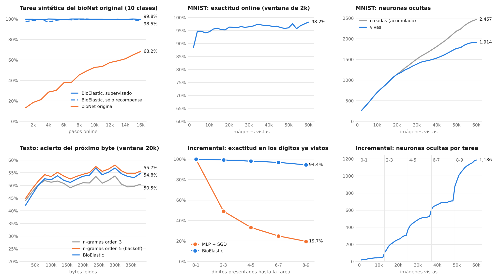

# bioelastic_snn

Red neuronal de spikes **bio-elástica**: aprende online, muestra por muestra, sin backprop ni
gradientes globales, y **crea y elimina neuronas según la información que recibe**. El mismo
núcleo procesa imagen, voz, texto o sensores; sólo cambia el encoder de entrada.

Sólo NumPy; núcleo y encoders en ~800 líneas.

```
dato crudo ──encoder──▶ volea de latencia ──línea de retardos──▶ capa elástica ──▶ decisión
(imagen, audio,          (un spike por          (el pasado llega      (STDP + k-WTA +     (3 factores:
 bytes, sensores)         aferente, t = 1 - s)   con spikes tardíos)   neurogénesis/poda)  error o recompensa)
```

## Resultados medidos

Todo en **una sola pasada online** (cada dato se ve una vez; se predice antes de aprender), en CPU,
con los **mismos hiperparámetros de red** en todas las modalidades (`theta=0.7`, `rho_sup=0.98`, `k=4`).

| Modalidad | Tarea | BioElastic | Referencia | Neuronas |
|---|---|---|---|---|
| Vector | Sintético del bioNet original, 10 clases, 16k pasos | **99.8 %** (99.9 % al paso 1000) | bioNet original: 68.2 % | 64 |
| Vector | Ídem, **sólo recompensa ±1, sin etiquetas** | **98.5 %** | — | 82 |
| Imagen | MNIST, test 10k | **97.2 %** en ~37 s | MLP+SGD sin ajustar, mismo flujo: 94.7 % | 1 914 |
| Voz | Dígitos hablados FSDD, audio frame a frame | **96.2 %** (media de 4 órdenes; 95.0–97.3) | — | ~900 |
| Texto | Próximo byte, tiny-shakespeare, últimos 100k de 400k | **54.6 %** | n-gramas orden 3: 50.8 % · orden 5: 55.8 % | 27 951 (vs 121 910 contextos del 5-grama) |
| Imagen | MNIST incremental por clases (5 tareas, sin repaso), 10 dígitos | **94.4 %** | MLP+SGD: 19.5 % (olvido catastrófico) | 1 186 |



El panel inferior derecho es la elasticidad: la red salta cada vez que aparecen dígitos nuevos y
se va aplanando mientras el flujo no cambia. En MNIST se crearon 2 467 neuronas y
553 murieron en su período crítico.

Los CSV de cada corrida están en `results/`.

## Cómo funciona

- **Formato común.** Todo dato se convierte en una *volea*: cada aferente dispara a lo sumo un spike,
  más temprano cuanto más fuerte (`t = 1 - s`). La red nunca sabe qué modalidad es.
- **Neurona exacta, sin paso de tiempo.** Integrate-and-fire con sinapsis de corriente; el instante
  del primer spike tiene forma cerrada (`neuron.py`), validada contra simulación paso a paso. El
  potencial al final de la ventana es el coseno entre pesos y entrada.
- **Capa elástica** (`layer.py`). Gana la primera neurona en disparar (k-WTA por latencia).
  - *Neurogénesis:* si ninguna neurona dispara (novedad) o la red se equivoca sin tener una
    neurona adecuada, la volea se imprime en una neurona nueva.
  - *Período crítico:* la neurona nueva que no vuelve a ser útil, muere.
  - *Consolidación:* la plasticidad de cada neurona y de sus sinapsis de salida decae con el uso.
    Lo aprendido no se pisa: para lo nuevo se crean neuronas.
  - *Presupuesto opcional:* con `max_neurons`, reclutar desaloja a la menos usada.
- **Secuencias por retardos** (`network.py`). El frame de hace `n` pasos llega con sus spikes
  atrasados, así el orden temporal queda escrito en una sola volea. Texto y voz usan esto;
  una imagen es una secuencia de largo 1.
- **Decisión de tres factores** (`readout.py`): `dW = lr · modulador · actividad`.
  `teach(y)` (error por salida), `reinforce(R)` (R-STDP, sólo recompensa) u `observe()` (sin supervisión).

## Uso

```bash
pip install -e ".[dev]"
pytest                                  # 27 tests
python experiments/exp_synthetic.py     # idem exp_mnist, exp_fsdd, exp_text, exp_incremental
python experiments/plot_results.py
```

```python
from bioelastic import BioElasticNet, ImageEncoder, AudioEncoder, TextEncoder

enc = ImageEncoder((28, 28))                         # imagen
net = BioElasticNet(enc.n_inputs, n_outputs=10)
pred = net.step(enc(img), label)                     # predice y después aprende

enc = AudioEncoder(sr=8000, n_bands=32, hop_ms=20)   # voz: frames de 20 ms
net = BioElasticNet(32, 10, context=8, delay=0.05)
pred = net.run_sequence(list(enc(wave)), label, decide="accumulate")

net = BioElasticNet(256, 256, context=8, delay=0.1)  # texto: bytes
for a, b in zip(data, data[1:]):
    pred = net.forward(int(a)); net.teach(int(b))

a = net.forward(x, explore=True); net.reinforce(+1.0 if ok else -1.0)   # sólo recompensa
net.save("red.npz"); net = BioElasticNet.load("red.npz")
```

## Límites conocidos

- **Una sola capa oculta de prototipos**, con campo receptivo global: no hay jerarquía ni
  invariancia a traslación. En MNIST queda por debajo de un modelo con backprop bien ajustado
  (98–99 %); el MLP de la tabla no está ajustado.
- **Texto:** rinde como un modelo de Markov de orden variable (entre 3- y 5-gramas, con 4× menos
  unidades). No es un modelo de lenguaje. Llega al tope de 30 000 neuronas y desaloja.
- **El tamaño crece con la complejidad del flujo**, no está acotado salvo con `max_neurons`.
- **Hiperparámetros elegidos mirando el test** de MNIST y FSDD (no hay split de validación):
  esas cifras son algo optimistas. Los de red son comunes; los de encoder (`blur`, rango dinámico,
  `hop`) y `context`/`delay` se fijaron por modalidad.
- **FSDD:** test de 300 palabras (±1.2 puntos) y los locutores de test están también en entrenamiento.
- **Sólo recompensa:** probado únicamente en la tarea sintética.
- La ganancia de entrada usa la norma de la volea completa (no es causal dentro de la ventana).
- No implementado: jerarquía/convolución, crítico TD(λ) para recompensa retardada, backend
  PyTorch/GPU. La homeostasis de umbral existe (`theta_plus`) pero viene apagada: no mejoró nada.

## Diagnóstico del bioNet original (`legacy/`)

- Ninguna de las tres versiones crea ni poda neuronas: la arquitectura es fija.
- La tarea sintética no era el límite: un centroide por clase la resuelve al ~100 %.
- `apply_supervised_nudge` usa la traza presináptica al **final** del episodio. Con decaimiento
  0.951/paso en 140 pasos, una aferente fuerte (spike en t=5) pesa 0.001 y una débil (t=90) 0.086:
  el refuerzo supervisado premiaba ~70× más a las entradas débiles.
- Un solo spike de salida por episodio: `e_norm_nonpred` es 0.0 en todo el CSV; sólo aprende la
  población ganadora.
- `B`: en los pasos con nudge la etiqueta entra al forward vía feedback, así que `acc_win` no es
  una métrica limpia (`acc_eval` sí).
- `v2_3a`: `conf_ema` mezcla latencia y `mean|Fw|`, y esa mezcla decide el corte de L1.
- `rebase_guarded`: `winners_win` recibe una muestra cada 1000 pasos; el rollback de lambda compara
  la exactitud contra sí misma y revierte siempre.
