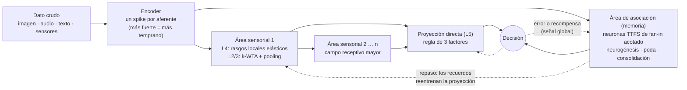

# bioelastic_snn

Red neuronal de spikes **bio-elástica** y **profunda**: aprende online, muestra por muestra, sin
backprop ni gradientes globales; **crea y elimina neuronas según la información que recibe**; y el
mismo núcleo procesa imagen, voz, texto o sensores (sólo cambia el encoder).

NumPy (y SciPy para el encoder de imagen). 41 tests. Todo lo que figura abajo está medido y se reproduce con los scripts de
`experiments/` (los CSV de cada corrida están en `results/`).

## Arquitectura



Tres sistemas que aprenden a velocidades distintas, todos con reglas locales:

- **Áreas sensoriales** (`FeatureArea`): cada nivel compara parches locales contra un diccionario
  de rasgos que crece por novedad y pierde los rasgos que no se reutilizan. Sin supervisión.
- **Memoria** (`BioElasticNet`): una neurona nueva guarda en un solo disparo lo que la red no
  reconoce o clasifica mal; las que no vuelven a servir mueren; las que se usan se consolidan.
- **Proyección directa** (`Cortex.proj`): las salidas aprenden despacio sobre los rasgos con
  `dW = tasa · (error o recompensa) · actividad`.
- **Repaso** (`replay`): los patrones guardados en la memoria se reactivan, recorren las áreas
  sensoriales y reentrenan la proyección. Es lo que impide que lo nuevo borre lo viejo.

| Cerebro | En el código | Estado |
|---|---|---|
| Retina, cóclea, tálamo | `encoders.py`: código de latencia | hecho |
| Corteza sensorial, lámina 4 (células simples) | `FeatureArea`: diccionario elástico de rasgos locales | hecho |
| Láminas 2/3 (inhibición lateral, células complejas, salida al área siguiente) | k-WTA + pooling en `FeatureArea` | hecho |
| Lámina 5 (salida hacia la decisión) | `Cortex.proj`, regla de 3 factores | hecho |
| Hipocampo (memoria rápida) y su repetición | `BioElasticNet` + `replay` | hecho |
| Dopamina (señal global) | tercer factor: error (`teach`) o recompensa (`reinforce`) | hecho |
| Jerarquía de escalas temporales | áreas con retardos (`context`) o traza lenta (`tau`) | hecho |
| Láminas 6 y 1 (realimentación descendente, atención) | — | no implementado |
| Memoria de trabajo recurrente, lenguaje, planificación | — | no implementado |
| Cerebelo (69 de los 86 mil millones de neuronas) | — | no modelado |

## Resultados medidos

Una sola pasada online (cada dato se ve una vez; se predice antes de aprender), en CPU. La red
profunda usa **la misma configuración** en imagen y en voz.

| Tarea | 1 nivel | 2 niveles | 3 niveles | Referencia |
|---|---|---|---|---|
| MNIST (test 10k) | 96.8 % | **98.5 %** | 98.5 % | MLP con backprop, misma pasada: 95.8 % |
| Fashion-MNIST (test 10k) | 82.6 % | **89.0 %** | 88.9 % | MLP con backprop, misma pasada: 83.5 % |
| Voz: dígitos hablados FSDD (test 300, media de 4 órdenes) | 94.5 % | **98.0 %** | 98.0 % | — |
| MNIST incremental por clases, sin volver a ver datos | 95.3 % | **96.4 %** | — | MLP con backprop: 19.6 % |

| Otras pruebas | Resultado | Referencia |
|---|---|---|
| Voz frame a frame (streaming, 1 nivel) | 96.2 % (95.0–97.3) | — |
| Texto: próximo byte, últimos 100k de 400k | 54.6 % con 27 918 neuronas y 3.6 MB de sinapsis | 3-gramas 50.8 % · 5-gramas 55.8 % (121 910 contextos) |
| Memoria: recordar una clave tras 10–30 distractores | 94.2 % con un área de traza lenta | sólo ventana de 8 pasos: 18.6 % (azar: 25 %) |
| Sintético del bioNet original, 10 clases, 16k pasos | 99.8 % · sólo recompensa, sin etiquetas: 98.5 % | bioNet original: 68.2 % |


Lo que dicen estos números:

- **El primer nivel sensorial es el que rinde**: reduce el error entre un 37 % (Fashion-MNIST) y un
  64 % (voz). **El segundo nivel no suma** en entradas de 28×28 o 24×32, y cuesta más del doble de
  tiempo.
- **Sin repaso, la red profunda olvida** (33.4 % en incremental): la proyección directa sufre el
  mismo olvido catastrófico que el backprop. Con repaso queda en 96.4 %.
- **En texto, agregar áreas no mejoró**: en una prueba aparte a 120k bytes (no incluida en
  `results/`), 53.8 % con una y 53.5 % con una segunda de traza lenta. Rinde como un Markov de
  orden variable, no como un modelo de lenguaje.
- La memoria crece con lo que el flujo le exige: 2 068 neuronas en MNIST, 6 900 en Fashion-MNIST.
- **No es una red chica**: con 2 niveles usa 0.8 M de sinapsis en MNIST y 2.2 M en Fashion-MNIST;
  el MLP de referencia, 0.2 M.

## Escala: qué significa «capacidad humana»

| | Cerebro humano | Transformer abierto de referencia | Esta red |
|---|---|---|---|
| Unidades | 86 mil millones de neuronas (16 mil millones en la corteza) | Llama 3.1 405B: 126 capas × 16 384 de ancho | 10 millones instanciadas (medido) |
| Conexiones | ~1.5 × 10¹⁴ sinapsis en la neocorteza, ~7 000 por neurona | 4.05 × 10¹¹ parámetros | 3.2 × 10⁸ sinapsis (medido) |
| Organización | 180 áreas por hemisferio, 6 láminas, ~10 niveles en la jerarquía visual (macaco) | capas idénticas en serie | áreas apilables; probado con 3 sensoriales + asociación |

Las arquitecturas de los modelos cerrados (Claude incluido) no son públicas; por eso la referencia
es Llama.

La red está construida para que el tamaño no cambie el costo unitario: cada neurona guarda a lo
sumo `fan_in` sinapsis (memoria = neuronas × fan-in × 8 bytes, sin importar cuántas entradas
existan) y las columnas son independientes entre sí. Medido en esta máquina (un núcleo):

| Neuronas | Sinapsis | Memoria de sinapsis | ns por sinapsis |
|---|---|---|---|
| 100 mil | 3.2 M | 25.6 MB | 2.4 |
| 1 millón | 32 M | 256 MB | 2.9 |
| 10 millones | 320 M | 2.56 GB | 2.7 |


Extrapolado con esos costos (`python -m bioelastic.blueprint`):

| Escala | Neuronas | Sinapsis | Memoria | Núcleo-segundos por paso |
|---|---|---|---|---|
| 10⁻⁶ | 16 mil | 112 M | 896 MB | 0.3 |
| 10⁻⁴ | 1.6 M | 11.2 mil M | 89.6 GB | 30 |
| 10⁻² | 160 M | 1.12 × 10¹² | 8.96 TB | 3 000 |
| **1 (corteza humana)** | **16 mil M** | **1.12 × 10¹⁴** | **896 TB** | **303 000** |

Es decir: llegar a la cantidad de neuronas y sinapsis de la corteza es un problema de hardware
(~0.9 PB de memoria y un clúster), no de diseño. Como orden de magnitud real: en 2013 el K computer
simuló 1.73 mil millones de neuronas y 10.4 billones de sinapsis con 82 944 procesadores y ~1 PB,
y tardó 40 minutos por segundo biológico.

**Lo que esto no dice:** igualar la cantidad no iguala la capacidad. Nada de lo medido acá muestra
razonamiento; muestra clasificación, memoria asociativa y predicción de secuencias cortas.

## Uso

```bash
pip install -e ".[dev]"
pytest                                    # 41 tests
python experiments/exp_vision.py mnist    # idem: fashion
python experiments/exp_fsdd.py            # voz
python experiments/exp_incremental.py     # incremental por clases
python experiments/exp_text.py            # texto
python experiments/exp_memory.py          # memoria de trabajo
python experiments/exp_synthetic.py       # tarea del bioNet original
python experiments/exp_scaling.py         # escalado hasta 10 M de neuronas
python experiments/plot_results.py && python experiments/report.py
```

```python
from bioelastic import Cortex, ImageEncoder

enc = ImageEncoder((28, 28), blur=0.4)
net = Cortex((28, 28, 1), n_outputs=10,
             areas=[dict(rf=5, pool=2, max_features=256, theta=0.95, floor=0.3, k=8)],  # + niveles: más dicts
             heads=[dict(source="input")],          # memoria elástica sobre la entrada
             projection=dict(source="all"),         # salida directa desde todas las áreas
             replay=0.5, joint=False)               # un repaso cada dos muestras
pred = net.step(enc(img).reshape(28, 28, 1), label)   # predice y después aprende
net.add_head(source="top")                            # un área más, en caliente
net.save("red.npz"); net = Cortex.load("red.npz")

text = Cortex(256, 256, heads=[dict(context=8, delay=0.1)])          # bytes, línea de retardos
mem = Cortex(13, 4, heads=[dict(context=8), dict(tau=32.0)])         # + área de traza lenta
a = net.forward(x, explore=True); net.reinforce(+1.0 if ok else -1.0)  # sólo recompensa
```

## Datos

Todos públicos y descargados de repositorios públicos la primera vez que se usan:
MNIST ([fgnt/mnist](https://github.com/fgnt/mnist)),
Fashion-MNIST ([zalandoresearch/fashion-mnist](https://github.com/zalandoresearch/fashion-mnist)),
Free Spoken Digit Dataset ([Jakobovski/free-spoken-digit-dataset](https://github.com/Jakobovski/free-spoken-digit-dataset)),
tiny-shakespeare ([karpathy/char-rnn](https://github.com/karpathy/char-rnn)).

## Límites

- **No corre a escala humana**: la mayor instancia medida tiene 10 millones de neuronas con
  fan-in 32. La fila «corteza humana» es una extrapolación de costo, no un experimento.
- **Profundidad**: más de un nivel sensorial no mejoró en estas tareas chicas. Falta probarlo en
  entradas grandes, donde hay lugar para más niveles.
- **Las áreas sensoriales comparten pesos entre posiciones** (como una convolución). Un cerebro no
  lo hace; sin compartir, las sinapsis se multiplican por el número de posiciones.
- **Texto**: nivel de n-gramas. No hay representación distribuida ni composición.
- **Referencias modestas**: el MLP es chico y de una sola pasada (se probó con 3 tasas y se informa
  la mejor). Una CNN con backprop y varias épocas supera estos números (~99.5 % en MNIST, ~93 % en
  Fashion-MNIST).
- **Selección de hiperparámetros**: la configuración profunda se eligió con una porción de
  validación tomada del entrenamiento y se usó sin cambios en voz, pero parte de la exploración
  previa miró subconjuntos del test de MNIST y Fashion-MNIST: esas cifras son algo optimistas.
- **Voz**: test de 300 palabras, con los mismos locutores que el entrenamiento.
- **Costo**: Python/NumPy en un núcleo; ~3.4 ms por imagen con 2 niveles, ~9 ms con 3.
- En las áreas sensoriales la latencia de salida se calcula desde el potencial final, no desde el
  cruce exacto del umbral (en la memoria sí es exacto).
- El repaso usa lo que la red guardó en sus propias neuronas, no los datos originales, pero es
  cómputo extra: medio pase adicional por muestra.

## Fuentes

- Neuronas: Azevedo et al. 2009 — https://pubmed.ncbi.nlm.nih.gov/19226510/
- Sinapsis: Pakkenberg et al. 2003 — https://pubmed.ncbi.nlm.nih.gov/12543266/ · por neurona:
  https://bionumbers.hms.harvard.edu/bionumber.aspx?id=112055
- Áreas corticales: Glasser et al. 2016 — https://pmc.ncbi.nlm.nih.gov/articles/PMC4990127
- Jerarquía visual: Felleman & Van Essen 1991 — https://chd.ucsd.edu/_files/fall2008/Felleman.1991.CC_Part1.pdf
- Láminas y sentido de las conexiones: Markov et al. 2014 — https://pmc.ncbi.nlm.nih.gov/articles/PMC4255240
- K computer: RIKEN 2013 — https://www.riken.jp/en/pr/press/2013/20130802_1/
- Llama 3.1 405B (config): https://huggingface.co/neuralmagic/Meta-Llama-3.1-405B-Instruct-FP8
