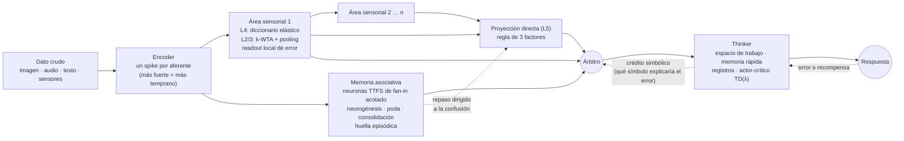

# bioelastic_snn

Red neuronal de spikes **bio-elástica**: aprende online, muestra por muestra, sin backprop ni
gradientes globales. **Crea y elimina neuronas según lo que recibe**, nunca deja de aprender y el
mismo núcleo procesa imagen, voz, texto o sensores (sólo cambia el encoder). Sobre la percepción
corre un **Thinker**: un lazo de razonamiento sobre símbolos con memoria rápida, registros y
aprendizaje por refuerzo.

NumPy (y SciPy para el encoder de imagen). **238 tests**, incluidos tests de regresión
bit a bit. Todo lo que figura abajo está medido con los scripts de `experiments/`, y los CSV de
cada corrida están en `results/`.

> **Estado (v0.3-dev, noviembre 2026).** Este README separa lo **medido** de lo que sigue
> siendo **hipótesis**. El objetivo del proyecto es encontrar dónde falla: la sección
> [Dónde falla](#dónde-falla) importa tanto como los resultados.
> Hay rondas en curso que implementan mecanismos del aprendizaje humano
> (ver [En curso](#en-curso-mecanismos-del-aprendizaje-humano)) y una
> [hoja de ruta](#hoja-de-ruta-hacia-el-aprendizaje-humano) con criterios de abandono.

## Arquitectura



| Cerebro | En el código | Estado |
|---|---|---|
| Retina, cóclea, tálamo | `encoders.py`: código de latencia | hecho |
| Corteza sensorial, lámina 4 | `FeatureArea`: diccionario elástico de rasgos locales | hecho |
| Láminas 2/3 (inhibición lateral, salida al área siguiente) | k-WTA + pooling en `FeatureArea` | hecho |
| Error local por área | readout de 3 factores por área (estilo Nøkland) | hecho |
| Lámina 5 (salida hacia la decisión) | `Cortex.proj` | hecho |
| Hipocampo (memoria rápida) y repaso | `BioElasticNet` + huella episódica + repaso dirigido | hecho |
| Dopamina: error de predicción de recompensa | TD(λ) con trazas en el Thinker; tercer factor en la percepción | hecho |
| Corteza prefrontal: memoria de trabajo | registros del Thinker, aprendidos en retrospectiva | hecho |
| Ligadura rápida tipo cabeza de inducción | `FastMemory` (por eventos, conjuntiva) | hecho |
| Láminas 6 y 1 (predicción descendente) | rama `agent/predictivo` | en curso |
| Cingulado anterior (detección del propio error), ACh/NE | `Cortex.signals()`, `metacog` (`metacog.py`), compuerta de fiabilidad (`posterior.py`) | opción; medido |
| Consolidación en sueño, reconsolidación, esquemas | rama `agent/consolidacion` | en curso |
| Aprender a aprender (prefrontal como meta-RL) | `prev_io` del Thinker, `MetaThinker` | hecho (ver resultados) |
| Mapa cognitivo recorrible en ambos sentidos | `back` del Thinker | hecho (opción); ya no daña la transitiva |
| Prefrontal: conjuntos de tareas y causa latente de cada regla | `task_sets` del Thinker (`tasksets.py`) | opción; falla con todo encendido |
| Estructura del mapa separada de lo sensorial (entorrinal) | `cogmap` del Thinker (`cogmap.py`) | opción |
| Dopamina, serotonina, acetilcolina y noradrenalina como meta-parámetros | `modulators` del Thinker (`modulators.py`) | opción |
| Cerebelo (69 de los 86 mil millones de neuronas) | — | no modelado |

## Resultados medidos


### Percepción (3 semillas, una sola pasada online)

| Test 10k | 1 nivel | 2 niveles | 3 niveles | CNN con backprop, misma pasada |
|---|---|---|---|---|
| MNIST | 96.9 ± 0.1 % | 98.9 ± 0.1 % | **99.0 ± 0.1 %** | 98.5 % (la mejor de 2) |
| Fashion-MNIST | 82.4 ± 0.3 % | **89.5 ± 0.4 %** | 89.4 ± 0.4 % | 88.3 % (la mejor de 2) |

Robustez con perturbaciones que la red nunca vio. En Fashion-MNIST, 2 niveles contra las dos CNN
(1 y 2 capas convolucionales):

| Perturbación | BioElastic | CNN de 1 capa | CNN de 2 capas |
|---|---|---|---|
| Ruido | **84.9 %** | 52.6 % | 79.7 % |
| Oclusión | **84.0 %** | 77.4 % | 72.8 % |
| Desplazamiento de 3 px | 51.1 % | 46.9 % | **56.0 %** |

En MNIST, con 3 niveles y contra la mejor CNN, la red gana en ruido (98.4 % contra 97.1 %) y en
oclusión (84.9 % contra 81.1 %). El desplazamiento la deja pareja con las CNN.

### Razonamiento sobre símbolos (Thinker, símbolos perfectos, 3–5 semillas)

| Prueba | Resultado | Azar |
|---|---|---|
| Ligadura de variables dentro del episodio | 100 % (red sin Thinker: 15.6 %) | 3.1 % |
| Cadenas de 3 y 4 saltos, nunca entrenadas | 100 % | 1.6 % |
| Composición f(f(x)) con x nunca vistos | 100 % (sin habla interna: 0 %) | 6.3 % |
| Composición de 5 a 8 saltos, con 16 distractores y 8 ruidos, vocabulario de 256 | 100 % | — |
| Suma decimal con acarreo aprendida desde cero (12 000 episodios), 8 dígitos exacta | 94.2 % (74.2–100 %) | ~0 % |

### Aprendizaje continuo (flujo no estacionario de 200 000 pasos, 3 semillas)

| Modelo | Exactitud final | Olvido |
|---|---|---|
| **BioElastic** | **89.9 ± 0.8 %** | 13.1 ± 1.3 % |
| MLP + replay | 85.7 ± 0.6 % | 22.1 ± 2.0 % |
| SLDA | 78.8 ± 1.7 % | 7.8 ± 1.2 % |
| kNN + buffer | 61.3 ± 1.9 % | 49.4 ± 0.9 % |

SLDA olvida menos pero aprende menos. Sin neurogénesis, la exactitud final cae a entre 31 % y 57 %
(flujo a escala 0.1): la plasticidad depende de crear neuronas.

**Clases parecidas (ronda continuo 2, 3 semillas).** Se entrenan primero unas prendas (C) y
después otras (D). Con la huella episódica, el repaso dirigido a la clase que más compite y la
separación al reclutar, el resultado sobre todas las clases sube de 0.651 a **0.776**, a la par de
ER-ACE con los mismos bytes (0.784). El pulóver, que antes se olvidaba por completo (~0.01), queda
en 0.42.

### Aprender a aprender (Thinker, 3 semillas)

Problemas al estilo Harlow: en cada uno aparecen 2 objetos nunca vistos, uno premiado, 6 ensayos.
El Thinker no ve el resultado como percepción: sólo recibe, como parte de su estado, cuál fue su
última respuesta y si fue premiada (`prev_io`). Después de entrenar, **se congelan los pesos** y se
mide en problemas nuevos.

| Problemas de entrenamiento | 10 | 25 | 50 | 200 |
|---|---|---|---|---|
| Acierto en el ensayo 2, pesos congelados | 0.52 ± 0.03 | 0.90 ± 0.07 | 1.00 ± 0.00 | 0.82 ± 0.13 |

Con los pesos fijos resuelve problemas nuevos en un ensayo: el aprendizaje rápido ocurre en el
estado, no en los pesos (como propone Wang et al. 2018 para la corteza prefrontal). Con 3 objetos
acierta 0.35, 0.66 y 0.82 en los ensayos 1 a 3, el óptimo de una memoria de un ensayo (0.33, 0.67, 0.83). Una reversión nunca vista se
corrige en un ensayo (0.83 en el ensayo siguiente). Control: si las dos señales entran por separado y no conjugadas,
queda en azar (0.50).

Mapa relacional: con la acción RETROCEDER (`back`) la relación inversa pasa de 0 % a 100 %
(pesos congelados, también con 8 elementos y cada relación vista una sola vez).

### Reglas que no se pisan, mapa del episodio y neuromoduladores (Thinker, 3 semillas)

Cada mecanismo es una opción apagada por defecto. Pesos congelados y problemas nuevos, salvo
aviso; configuración elegida en validación y medida una vez con otras semillas.

| Prueba | Sin el mecanismo | Con el mecanismo |
|---|---|---|
| Volver a una regla sin consigna después de 400 problemas de otra (`task_sets`, como en Collins & Frank 2013) | 0.08 ± 0.11 | 1.00 ± 0.00 |
| Batería C0–C6 mezclada, 12 medidas (`back`: los predecesores se ven sólo al retroceder) | `back` anterior: peor medida 0.72 (orden de 8, distancia ≥ 4) | las 12 en 1.00 |
| Harlow sin ver el resultado, peor instantánea por semilla desde el problema 50 (neuromoduladores) | 0.75 ± 0.05, 4 instantáneas bajo 0.95 | 1.00 ± 0.00, ninguna |
| Cierre de un anillo con relaciones mezcladas con preguntas (`cogmap` + neuromoduladores) | 0.67 ± 0.47 | 1.00 ± 0.00 |
| Dos regímenes, estable y volátil: elige el premiado | valores a mano 0.773 ± 0.005; los 7 ajustados por perturbación 0.50 ± 0.36 | 0.828 ± 0.010 (oráculo por régimen: 0.831 ± 0.010) |

Qué explica cada mejora, según las ablaciones:
- En los dos regímenes, toda la mejora viene de la memoria bayesiana: con ella sola y el control
  con valores fijos da el mismo 0.828. Los neuromoduladores no suman ahí.
- En Harlow, la mejora viene del horizonte de un ensayo que fija la serotonina: sin él, 0.49 ± 0.41.
  La causa de las caídas era el error de predicción de fin de episodio.
- En el anillo, los neuromoduladores bajan la relación inversa de 1.00 a 0.82.
- Mientras aprende (en línea, bloques 750–799), el cierre queda en 0.55 ± 0.02 en el anillo y en
  0.76 ± 0.03 en la línea con final.

### Percepción + razonamiento

| Prueba | Resultado |
|---|---|
| Percepción entrenada aparte, Thinker aprende a sumar sobre lo percibido (3 dígitos) | 71.9 % exacta (76.1 % con crédito simbólico); con símbolos perfectos, 97.4 % |
| L0: identidad aprendida sólo con el crédito del Thinker | pureza de la percepción 88–90 % |
| **L3: suma completa aprendida desde cero, todo junto** | **1.5 % exacta (0–4 %), 24 % por columna (azar: 10 %)** |
| **Suma con imágenes, regla conocida (MNIST-addition): crédito conjunto entre lo que ve y la suma; 27 500 pares, una pasada, test, 3 semillas** | **97.6 ± 0.2 % de sumas, 98.8 ± 0.1 % por dígito.** Error del dígito: AUROC 0.984, ECE 0.002. Publicado, con 30 000 pares y backprop: DeepProbLog 97.2 ± 0.5, A-NeSI 97.66, DeepStochLog 97.9 (citado en la tabla 1 de A-NeSI). Queda por encima de DeepProbLog, a la par de A-NeSI y por debajo de DeepStochLog |
| Atajo de razonamiento con 3 000 pares (8 semillas, test) | sin la compuerta de fiabilidad caen 4 de 8 (dígito ≈ 0.01); con ella, 0 de 8: suma 93.8 ± 0.6 %, dígito 96.8 ± 0.3 %. DeepProbLog con 3 000 pares, otro protocolo: 92.2 ± 1.6 |
| L3 por etapas: categorías sin etiquetas y después ligadura, regla desconocida (validación, 1 semilla) | las categorías llegan a una pureza de 0.79 (hace falta ≥ 0.965); después de ligar, símbolos 0.33 y 0.2 % exacta |

### Saber cuándo se equivoca (`Cortex` con `metacog`, flujo continuo, 3 semillas)

| Medida | Escala 0.05 | Escala 0.1 |
|---|---|---|
| AUROC del propio error, confianza calibrada | 0.855 ± 0.003 | 0.885 ± 0.001 |
| ECE calibrada | 0.014 ± 0.001 | 0.012 ± 0.001 |
| Apuesta por confianza (Kepecs 2008): AUROC acierto contra error | 0.845 ± 0.017 | 0.870 ± 0.018 |
| Pendiente de la apuesta contra la facilidad: aciertos / errores | +0.26 / −0.17 | +0.23 / −0.11 |
| Entre los errores, nuevo contra conocido: señal NE | 0.851 ± 0.018 | 0.890 ± 0.020 |

- **Firma de Kepecs:** reproduce la que se midió en ratas. En los aciertos, la apuesta sube con la
  facilidad; en los errores, baja.
- **Error contra novedad:** la confianza no distingue un error en algo conocido de uno ante algo
  nuevo (0.52). La señal NE sí los distingue.
- **Hipercorrección:** no tiene efecto propio. Lo que acelera la corrección (de 102.5 a 82.7 pasos)
  es aplicar más plasticidad en los errores. El control con la misma ganancia, sin ponderar por
  confianza, da lo mismo (82.0).

### Rendimiento

El índice invertido exacto de la capa dispersa es idéntico bit a bit a la pasada densa y da entre
1.2 y 3 veces más velocidad. Una imagen con 2 niveles tarda ~4 ms en un núcleo de Python/NumPy.

## Comparación con referencias publicadas

La batería (`experiments/battery/`, `python3 experiments/exp_battery.py correr`) mide cada
prueba contra una referencia y marca si la comparación es **equivalente**: misma entrada y mismo
protocolo que el estudio. El índice es (red − azar) / (referencia − azar): 1 iguala la referencia
y 0 es azar. Las referencias son cifras publicadas, salvo donde dice «línea base local», que es
otro modelo corrido acá con los mismos datos. «R3» son las opciones de razonamiento 3 encendidas:
`prev_io`, `back`, `cogmap` y `modulators`.

Hoy solo 3 de 10 dimensiones tienen una comparación equivalente con personas o animales. Por eso
no hay un «porcentaje humano» global: un promedio no sería informativo.

**Equivalentes** (3 semillas, salvo aviso):

| Prueba | Red | Referencia | Índice |
|---|---|---|---|
| MNIST, 2 niveles | 98.9 % | personas 99.8 % (Keysers 2007) | 0.99 |
| Fashion-MNIST, 2 niveles | 89.5 % | personas 83.5 % (Zalando) | 1.08 |
| CIFAR-10, 2 niveles; 5 000 imágenes de entrenamiento de 50 000 y las primeras 5 000 del test | 48.1 ± 0.4 % | personas 95.2 % (CIFAR-10H) | 0.45 |
| Omniglot: un solo ejemplo, 20 opciones; imágenes de 28 × 28 en lugar de 105 × 105, lector de la batería sobre V1 | 28.8 ± 0.9 % | personas ≥ 95.5 % (Lake, Salakhutdinov & Tenenbaum 2015) | ≤ 0.26 |
| Harlow con objetos vistos, misma cantidad de problemas que los monos | 0.72 ± 0.04; con R3, 0.94 ± 0.02 (el techo es ~0.94 por colisiones de la percepción) | monos rhesus: 0.52 en los primeros 8 problemas (Harlow 1949) y 0.82 en los problemas 33–132 (Harlow 1950). Con R3, la red da 0.79 y 0.94 en esos tramos | — |
| Saber cuándo se equivoca: AUROC de tipo 2 en una decisión visual con dificultad igualada | 0.748 ± 0.007 | personas 0.55–0.75 (Fleming et al. 2010) | dentro del rango, en el borde superior |
| Igual/distinto con figuras nuevas; «igual» es una copia idéntica, como con los animales | 0.85 ± 0.03 (azar 0.5); con la copia corrida 2 px, 0.68; con dos dibujos del mismo carácter, 0.62 | con 8 figuras, rhesus, capuchinos y palomas no transfieren (Katz, Sturz & Wright 2010) | — |
| MNIST-addition: 27 500 pares, una pasada | 97.6 % | DeepProbLog 97.2 ± 0.5; A-NeSI 97.66; DeepStochLog 97.9 (citado en la tabla 1 de A-NeSI); todos con backprop | — |
| Split-MNIST por clases, una pasada | 96.6 % | publicado, con otros presupuestos de memoria (van de Ven, Tuytelaars & Tolias 2022): entrenamiento conjunto 98.2, BI-R 94.4, iCaRL 92.5, ER 88.8, EWC 20.6. Línea base local con los mismos bytes: ER-ACE 95.0 | — |
| Split-Fashion por clases, una pasada | 80.9 % | sin cifra publicada verificada. Línea base local con los mismos bytes: ER-ACE 84.3, ER 85.2 | — |
| Texto no visto, 600 KB de habla dirigida a niños; 1 corrida, porque la red es determinista dado el corpus | 2.96 bits/byte (2.54 con la temperatura elegida en validación) | línea base local: n-grama Kneser-Ney de orden 8 con los mismos datos, 1.43 | — |

En igual/distinto, la red transfiere la identidad de los píxeles, no un concepto robusto.

**No equivalentes:** otra entrada u otro procedimiento. No se promedian con las de arriba.

| Prueba | Red | Referencia | Por qué no es equivalente |
|---|---|---|---|
| Harlow con símbolos | 0.76 ± 0.05; con R3, 1.00 | — | símbolos en lugar de objetos vistos |
| Inferencia transitiva, serie de 5 (par BD) | 0.50 ± 0.50 | palomas 0.875 (von Fersen et al. 1991) | ídem |
| Inferencia transitiva, serie de 6 | 0.25 ± 0.22 | personas 0.743 (Siemann & Delius 1996) | ídem |
| Inferencia transitiva, serie de 7, fase 3 (los 21 pares, con premio) | 0.961 ± 0.011 | sin cifra verificada (Jensen et al. 2017) | ídem |
| Más tasa de aprendizaje cuando el ambiente es volátil | 0.013 ± 0.079: sin efecto | personas: mayor en la fase volátil (Behrens et al. 2007) | ídem |
| Detección de cambio, capacidad K | 5.7 ± 4.3, bimodal; con R3, 8.5 ± 3.2 | personas 2.46; rhesus 0.71 | la memoria es exacta por diseño |
| Reversión serial | 4.0 errores por reversión (azar 70.4), sin mejora entre reversiones | sin cifra verificada | símbolos |
| Igual/distinto con símbolos | 0.50 | — | símbolos |
| MLC: instrucciones con pocos ejemplos | 0.00 | personas 0.807 (Lake & Baroni 2023) | símbolos en lugar de palabras y colores |
| SCAN, experimento 1: 1, 2, 4 y 8 % de los comandos | 0.00 en las cuatro | mejor seq2seq: ~0.05, ~0.54 y ~0.93 con 1, 2 y 4 % (Lake & Baroni 2018) | 1 semilla; se compara con un sistema |
| bAbI 1k, 20 tareas | error medio 52.8 % (pasa 2) | LSTM 51.3 % y MemN2N 13.9 % (Sukhbaatar et al. 2015); MemNN con hechos de apoyo, ~7 % (Weston et al. 2015) | 1 semilla; se compara con sistemas |
| BLiMP con 600 KB | 0.482, por debajo del azar (p = 0.04) y del n-grama de bytes (p = 0.014); la causa principal es la longitud | línea base local con los mismos datos: n-gramas 0.505–0.511. Personas 0.886 (Warstadt et al. 2020) | a esta escala ningún modelo supera al azar |

## Dónde falla

- **Aprender a ver y a razonar a la vez desde cero (L3) no funciona.** Por separado anda: la
  percepción supervisada y el Thinker con símbolos perfectos. Juntos, con el resultado final como
  única señal, el crédito no se reparte entre las imágenes y la regla.
  - **Con la regla conocida, el crédito conjunto sí funciona** (97.6 % en MNIST-addition).
  - **Con la regla desconocida y sin ningún ejemplo nombrado, tampoco funciona por etapas.** Las
    categorías sin etiquetas no son lo bastante puras (0.79 contra 0.965), y ligarlas a símbolos
    no llega a la cota.
  - **El mecanismo de ligadura se aplana:** con 3 prototipos por dígito da 0.60, 0.73 y 0.71 con
    10 000, 40 000 y 160 000 columnas. Es un límite de diseño, no de datos.
  - **Salir de un atajo ya consolidado es lento:** la identidad llega a 0.47 en 7 500 pares.
- **La profundidad no escala sola.** En Fashion el tercer nivel no suma. En CIFAR-10 (exploratorio,
  5 000 muestras, 1 semilla, en validación; es otra corrida que la de la tabla de comparación) el segundo nivel rinde menos que el primero (45 % contra
  47 % de la sonda local; la CNN, 44–46 %). Hipótesis en prueba: a las capas altas no les llega ninguna señal
  propia (no hay predicción descendente).
- **Clases viejas parecidas.** Quedan 0.13 por debajo de ER-ACE en el escenario de prendas. Cuando
  las clases llegan de a una, la proyección sobre las viejas cae a 0.2–0.4.
- **Costo.** Con 2 niveles, entrenar tarda entre 16 (MNIST) y 30 (Fashion) veces más que la CNN de
  referencia, y usa más sinapsis que un MLP.
- **Desplazamientos.** La CNN de 2 capas tolera mejor un desplazamiento de 3 px (56.0 % contra
  51.1 % en Fashion).
- **Texto.** Con los mismos 600 KB de habla dirigida a niños, predice peor que un n-grama de
  Kneser-Ney (línea base local): 2.96 bits por byte (2.54 con la temperatura elegida en validación)
  contra 1.43, y 0.677 contra 0.707 de próximo byte. Ya usa
  29 241 de sus 30 000 neuronas. Si con más neuronas y más datos tampoco lo supera, se cumple el
  criterio de abandono F.
- **Razonamiento composicional con benchmarks externos: cero.** SCAN, MLC y la mitad de bAbI
  fallan (ver la tabla de comparación). Las causas medidas son de diseño:
  - no ajusta ni los comandos que vio;
  - casi nunca decide terminar la respuesta;
  - guarda prototipos de comandos enteros, no significados por palabra;
  - pierde el orden de las palabras.

  La curva es plana entre 1 y 8 % de los datos. El Thinker razona sobre tareas formales chicas;
  no hay evidencia de razonamiento en lenguaje natural ni en dominios abiertos.
- **Aprender a aprender tiene límites medidos.** Ajustar por recompensa los meta-parámetros de la
  memoria rápida no escala: con 7 a la vez rinde peor que los valores elegidos a mano (0.50 ± 0.36).
  Lo que mejora los dos regímenes es la memoria bayesiana, no ese ajuste. Entre familias de reglas
  opuestas no hay aceleración. Sin las opciones nuevas, la regla nueva **sobrescribe la vieja**
  y el anillo no cierra. Con ellas, la vieja vuelve a 1.00 y el anillo cierra con los pesos
  congelados, pero mientras aprende el cierre queda en 0.55.
- **Todo encendido a la vez todavía no funciona.** Por eso las opciones de arriba quedan apagadas
  por defecto. Con todas encendidas (rama `agent/razonamiento3`, 3 semillas):
  - En la multitarea en bloques en orden inverso, C1 cae de 1.00 a 0.52, C4 a 0.68, C2 a 0.78 y
    C0 a 0.85: lo compuesto antes de aprender f no se repara cuando f llega.
  - C1 con 256 símbolos queda en 0.805 y 0.835 (1–2 y 3–4 saltos). La v0.3 da 0.835 y 0.888.
  - Con `task_sets`, fallan tres pruebas de multitarea con consignas. Volver a una tarea vieja
    queda entre 0.0 y 0.75.
  - Cada paso tarda 2.09 veces lo de la v0.3; el tope fijado es 2.
- **Selección de hiperparámetros.** Parte de la exploración previa miró subconjuntos del test de
  MNIST y Fashion: esas cifras son algo optimistas. Los resultados de la v0.3 usan validación
  separada.
- **Escala.** La mayor instancia medida tiene 10 millones de neuronas. La escala humana es una
  extrapolación de costo (~0.9 PB), no un experimento.

## En curso: mecanismos del aprendizaje humano

Cada mecanismo se implementa como opción del código, con tests, ≥3 semillas y ablación, y al final
se prueban todos juntos.

| Cómo aprende un humano | Fuente | Rama |
|---|---|---|
| Predicción de arriba hacia abajo; sube el error residual; plasticidad por error en cada nivel | Rao & Ballard 1999 | `agent/predictivo` |
| Detección del propio error por conflicto entre respuestas | Yeung, Botvinick & Cohen 2004 | **medido**: el conflicto predice el error (AUROC 0.874) |
| Los errores cometidos con mucha confianza se corrigen más | Butterfield & Metcalfe 2001, 2006 | **medido**: sin efecto propio |
| Incertidumbre esperada (ACh) e inesperada (NE) modulan inferencia y plasticidad | Yu & Dayan 2005 | **medido**: NE separa error de novedad (0.89) |
| Aprender pares palabra-objeto acumulando evidencia de escenas ambiguas | Smith & Yu 2008 | **medido**: con la regla conocida liga (97.6 %); sin ancla no |
| Etapas: "uno", "dos", "tres" y después el principio cardinal | Carey; Le Corre; Elman 1993 contra Rohde & Plaut 1999 | **medido**: contar primero los números chicos rinde peor que el orden aleatorio (pureza 0.30 contra 0.43) |
| Dos sistemas: memoria rápida y conocimiento lento intercalado | Kumaran, Hassabis & McClelland 2016 | `agent/consolidacion` |
| Lo que encaja en un esquema se consolida en un ensayo | Tse et al. 2007 | `agent/consolidacion` |
| Un recuerdo consolidado sólo se modifica si hay error de predicción | Sevenster, Beckers & Kindt 2013–2014 (y la replicación fallida de 2022) | `agent/consolidacion` |
| Recordar enseña más que releer; el espaciado retiene mejor | Roediger & Karpicke 2006 | `agent/consolidacion` |
| Sueño: repaso activo y renormalización sináptica global | Klinzing, Niethard & Born 2019 | `agent/consolidacion` |
| La dopamina entrena a la prefrontal para que sea un aprendiz rápido propio | Wang et al. 2018 | **medido** (ver resultados) |
| Mapas cognitivos: estructura relacional reutilizable | Behrens et al. 2018 | **medido** (ver resultados) |
| Las reglas se agrupan en conjuntos de tareas reutilizables; una causa latente decide cuál rige | Collins & Frank 2013 | **medido** como opción; con todo encendido, abierto |
| Los neuromoduladores fijan los meta-parámetros del aprendizaje | Doya 2002 | **medido** como opción; en los dos regímenes no suma |

## Hoja de ruta hacia el aprendizaje humano

Nadie tiene hoy un camino demostrado hasta la inteligencia humana con aprendizaje local y
online: es un problema abierto. Esta hoja de ruta ordena el trabajo por dependencias, mide
cada escalón contra un benchmark externo y fija de antemano qué resultado obligaría a cambiar
el diseño.

**Regla de diseño** (sale de lo medido). Antes de cambiar un peso, inferir qué causó el
resultado —qué módulo, qué recuerdo, qué causa latente, error o novedad— y aplicar la
plasticidad local en proporción a esa responsabilidad. Lo que funcionó la cumple: error local
por área, crédito conjunto en la suma con imágenes, conjuntos de tareas, búsqueda
contrafáctica que separa estrategia de conocimiento. Lo que falló la viola: crédito casilla
por casilla, reconsolidación ante cualquier error, compuertas gobernadas por una confianza
sin calibrar.

| Escalón | Qué tiene que lograr | Medida externa | Estado |
|---|---|---|---|
| A. Saber cuándo se equivoca | confianza calibrada; separar error de novedad | apuesta por confianza (ratas, Kepecs 2008); ECE ≤ 0.05; AUROC ≥ 0.85 | cumplido en el flujo continuo de `Cortex`, que no es equivalente: AUROC 0.855, 0.886 y 0.909 en tres escalas; ECE 0.010; firma de Kepecs; NE separa error de novedad (0.89). Con el protocolo equivalente de Fleming da 0.748, dentro del rango humano (0.55–0.75), donde el umbral de 0.85 no aplica. Falta llevarlo al Thinker |
| B. Símbolos anclados en lo que ve | crédito conjunto entre percepción y razonamiento | MNIST-addition (DeepProbLog: 97.2 % con 30 000 pares); después con la regla desconocida | regla conocida: 97.6 ± 0.2 % en test (3 semillas, una pasada), a la par de lo publicado. Regla desconocida sin ancla: no funciona |
| C. Abstracción por niveles | que cada nivel aporte; invariancia | CIFAR-10 contra Hebb local publicado (SoftHebb: 80.3 %, con otro protocolo); sonda por nivel; desplazamientos | abierto: el nivel 2 copia al 1 |
| D. Memoria sin interferencia | actualizar o crear según la causa inferida | Split-MNIST y Split-Fashion incremental por clases; ER-ACE con los mismos bytes | en curso |
| E. Razonamiento composicional | generalizar a combinaciones nuevas | SCAN, bAbI; datos de personas de Lake y Baroni 2023 | medido, falla: SCAN 0 %, MLC 0 %, bAbI 52.8 % de error. Rediseño de entrada, salida y memoria en curso (rama `agent/composicion`) |
| F. Lenguaje | predecir y componer sobre secuencias | BabyLM (10 M de palabras, escala de un niño) a escala reducida | medido con 600 KB: peor que un n-grama con los mismos datos (2.96 bits/byte, o 2.54 con la temperatura de validación, contra 1.43); curva de escalado en curso |
| G. Razonar con neuronas | memoria de trabajo y ligadura en neuronas de spikes, no en estructuras programadas | las pruebas de E, sin pérdida | sin empezar |
| H. Actuar y explorar | elegir qué mirar y qué preguntar; metas propias | pruebas de cognición animal (igual/distinto, inferencia transitiva, Harlow); BabyAI | las pruebas animales ya se miden en la batería (ver la comparación); el mecanismo de actuar y explorar, sin empezar |

**Hardware o arquitectura.** Una capacidad sólo se da por «limitada por el hardware» si su
curva de escalado (exactitud contra neuronas y datos, en 3 escalas o más) sigue subiendo. Si
se aplana, el límite es de diseño y hay que corregirlo.

**Criterios de abandono.**
- C: si con ancho creciente por nivel y aprendizaje de invariancia por continuidad temporal la
  sonda del nivel 2 no supera a la del 1, la pila de áreas hacia adelante es el diseño
  equivocado y se reemplaza.
- F: si a escala reducida no supera a un modelo de n-gramas con los mismos datos, el mecanismo
  de secuencias es el equivocado.
- G: si al pasar la memoria de trabajo a neuronas se pierde el razonamiento ya logrado, el
  Thinker es un programa con control aprendido y no una red.

## Escala: qué significa «capacidad humana»

| | Cerebro humano | Transformer abierto de referencia | Esta red |
|---|---|---|---|
| Unidades | 86 mil millones de neuronas (16 mil millones en la corteza) | Llama 3.1 405B: 126 capas × 16 384 de ancho | 10 millones instanciadas (medido) |
| Conexiones | ~1.5 × 10¹⁴ sinapsis en la neocorteza | 4.05 × 10¹¹ parámetros | 3.2 × 10⁸ sinapsis (medido) |
| Organización | 180 áreas por hemisferio, 6 láminas, ~10 niveles en la jerarquía visual | capas idénticas en serie | áreas apilables; probado hasta 3 sensoriales + asociación + Thinker |

Cada neurona guarda a lo sumo `fan_in` sinapsis y las columnas son independientes: el costo por
sinapsis medido es constante (2.4–2.9 ns) de 100 mil a 10 millones de neuronas.


| Escala | Neuronas | Sinapsis | Memoria | Núcleo-segundos por paso |
|---|---|---|---|---|
| 10⁻⁴ | 1.6 M | 11.2 mil M | 89.6 GB | 30 |
| 10⁻² | 160 M | 1.12 × 10¹² | 8.96 TB | 3 000 |
| **1 (corteza humana)** | **16 mil M** | **1.12 × 10¹⁴** | **896 TB** | **303 000** |

Igualar la cantidad no iguala la capacidad. Lo que mide la profundidad útil de esta red es la
sección de resultados, no esta tabla.

## Uso

```bash
pip install -e ".[dev]"
pytest                                          # 238 tests
python experiments/exp_vision.py mnist          # idem: fashion, cifar10
python experiments/exp_fsdd.py                  # voz
python experiments/exp_continual.py             # flujo continuo no estacionario
python experiments/exp_interference.py          # clases parecidas
python experiments/exp_thinking_hard.py         # razonamiento: composición, cadenas
python experiments/exp_thinking_r2.py           # razonamiento: ablaciones y pruebas adversariales
python experiments/exp_integration2.py conjunta # percepción + razonamiento desde cero
python experiments/plot_v03.py                  # figura de esta página
```

```python
from bioelastic import Cortex, ImageEncoder
from bioelastic.thinker import Thinker

enc = ImageEncoder((28, 28), blur=0.4)
net = Cortex((28, 28, 1), n_outputs=10,                 # = "depth2" de exp_vision.py
             areas=[dict(rf=5, pool=2, max_features=256, theta=0.95, floor=0.3, k=8,
                         local=dict(lr=0.5))],            # error local del área
             heads=[dict(source="input")], projection=dict(source="all", balance=True),
             arbiter=0.01, replay=0.5, joint=False)
pred = net.step(enc(img).reshape(28, 28, 1), label)   # predice y después aprende

th = Thinker(n_symbols=20, memory=True, registers=2)
th.observe((3, 7)); out = th.answer((3,)); th.feedback(target=7)
```

## Datos

Todos públicos, descargados de repositorios públicos la primera vez que se usan:
MNIST ([fgnt/mnist](https://github.com/fgnt/mnist)),
Fashion-MNIST ([zalandoresearch/fashion-mnist](https://github.com/zalandoresearch/fashion-mnist)),
CIFAR-10 (copia binaria en [NTU-ALComLab/IWLS2021](https://github.com/NTU-ALComLab/IWLS2021)),
Free Spoken Digit Dataset ([Jakobovski/free-spoken-digit-dataset](https://github.com/Jakobovski/free-spoken-digit-dataset)),
tiny-shakespeare ([karpathy/char-rnn](https://github.com/karpathy/char-rnn)).

## Fuentes

- Neuronas: Azevedo et al. 2009 — https://pubmed.ncbi.nlm.nih.gov/19226510/
- Sinapsis: Pakkenberg et al. 2003 — https://pubmed.ncbi.nlm.nih.gov/12543266/
- Áreas corticales: Glasser et al. 2016 — https://pmc.ncbi.nlm.nih.gov/articles/PMC4990127
- Jerarquía visual: Felleman & Van Essen 1991
- K computer: RIKEN 2013 — https://www.riken.jp/en/pr/press/2013/20130802_1/
- Llama 3.1 405B (config): https://huggingface.co/neuralmagic/Meta-Llama-3.1-405B-Instruct-FP8
- Dopamina y error de predicción: Schultz, Dayan & Montague 1997 — https://pubmed.ncbi.nlm.nih.gov/9054347/
- Codificación predictiva: Rao & Ballard 1999 — https://pubmed.ncbi.nlm.nih.gov/10195184/
- Sistemas complementarios: Kumaran, Hassabis & McClelland 2016 — https://web.stanford.edu/~jlmcc/papers/KumaranHassabisMcClelland16FinalMS.pdf
- Esquemas: Tse et al. 2007 — https://pubmed.ncbi.nlm.nih.gov/17412951/
- Hipercorrección: Butterfield & Metcalfe 2006 — https://link.springer.com/article/10.1007/s11409-006-6894-z
- Detección de errores: Yeung, Botvinick & Cohen 2004 — https://www.ece.uvic.ca/~bctill/papers/learning/Yeung_etal_2004a.pdf
- ACh y NE: Yu & Dayan 2005 — https://princetonuniversity.github.io/NEU-PSY-502/_static/pdf/Class%208/Yu2005.pdf
- Reconsolidación: Sevenster, Beckers & Kindt 2014 — https://pmc.ncbi.nlm.nih.gov/articles/PMC4201815 · replicación fallida 2022 — https://dare.uva.nl/id/13529732-f331-4b02-9d1f-b520022508c3
- Efecto de testeo: Roediger & Karpicke 2006 — https://psychology.ecu.edu/wp-content/pv-uploads/sites/216/2019/03/Roediger-Karpicke-2006.pdf
- Sueño: Klinzing, Niethard & Born 2019 — https://www.nature.com/articles/s41593-019-0467-3
- Aprendizaje trans-situacional: Smith & Yu 2008 — https://pmc.ncbi.nlm.nih.gov/articles/PMC2271000
- Número: Le Corre & Carey; Piantadosi, Tenenbaum & Goodman 2012 — https://web.stanford.edu/%7engoodman/papers/COGNIT2374.pdf
- Empezar simple: Elman 1993 — https://web.cs.swarthmore.edu/~meeden/cogs1/s07/elman_cognition1993.pdf · Rohde & Plaut 1999 — https://www.cnbc.cmu.edu/~plaut/papers/pdf/RohdePlaut99Cog.startingSmall.pdf
- Prefrontal como meta-RL: Wang et al. 2018 — https://www.nature.com/articles/s41593-018-0147-8
- Mapas cognitivos: Behrens et al. 2018 — https://www.pubmed.gov/30359611/
- Suma con imágenes: Manhaeve et al., DeepProbLog — https://arxiv.org/pdf/1907.08194 · Dai et al. 2019, aprendizaje abductivo — https://proceedings.neurips.cc/paper/2019/hash/9c19a2aa1d84e04b0bd4bc888792bd1e-Abstract.html · atajos de razonamiento: Marconato et al. 2023 — https://arxiv.org/pdf/2302.01242
- Causas latentes: Gershman, Monfils, Norman & Niv 2017 — https://elifesciences.org/articles/23763v2
- Conjuntos de tareas: Collins & Frank 2013 — https://pmc.ncbi.nlm.nih.gov/articles/PMC3974273
- Neuromoduladores y meta-aprendizaje: Doya 2002 — https://doi.org/10.1016/S0893-6080(02)00044-8
- Mapa estructural: Whittington et al. 2020 — https://pmc.ncbi.nlm.nih.gov/articles/PMC7707106
- Inhibición lateral anti-Hebbiana: Földiák 1990 — https://link.springer.com/doi/10.1007/BF02331346
- Hebb local multicapa: Journé et al. 2023, SoftHebb — https://arxiv.org/abs/2209.11883v2
- Invariancia con plasticidad predictiva: Halvagal & Zenke 2023 — https://www.ncbi.nlm.nih.gov/pmc/articles/PMC10620089/
- Escalado de algoritmos biológicos: Bartunov et al. 2018 — https://arxiv.org/abs/1807.04587
- Composicionalidad con meta-aprendizaje: Lake & Baroni 2023 — https://pmc.ncbi.nlm.nih.gov/articles/PMC10620072
- Lenguaje con datos de escala infantil: BabyLM — https://arxiv.org/html/2504.08165v1
- Prueba de Turing encarnada: Zador et al. 2023 — https://www.ncbi.nlm.nih.gov/pmc/articles/PMC10033876/
- Confianza en ratas: Kepecs et al. 2008 — https://doi.org/10.1038/nature07200 · conceptos en abejas: Giurfa et al. 2001 — https://www.doi.org/10.1038/35073582
