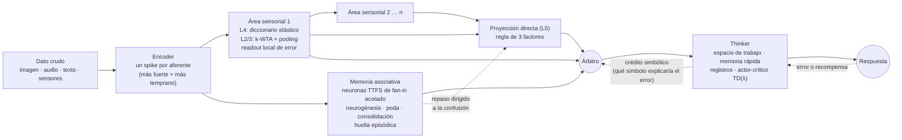
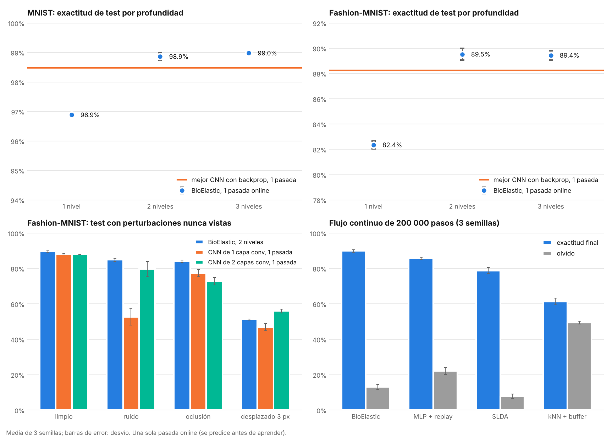

# bioelastic_snn

Red neuronal de spikes **bio-elástica**: aprende online, muestra por muestra, sin backprop ni
gradientes globales. **Crea y elimina neuronas según lo que recibe**, nunca deja de aprender y el
mismo núcleo procesa imagen, voz, texto o sensores (sólo cambia el encoder). Sobre la percepción
corre un **Thinker**: un lazo de razonamiento sobre símbolos con memoria rápida, registros y
aprendizaje por refuerzo.

NumPy (y SciPy para el encoder de imagen). **143 tests**, incluidos tests de regresión
bit a bit. Todo lo que figura abajo está medido con los scripts de `experiments/`, y los CSV de
cada corrida están en `results/`.

> **Estado (v0.3-dev, noviembre 2026).** Este README separa lo **medido** de lo que sigue
> siendo **hipótesis**. El objetivo del proyecto es encontrar dónde falla: la sección
> [Dónde falla](#dónde-falla) importa tanto como los resultados.
> Hay cuatro rondas en curso que implementan mecanismos del aprendizaje humano
> (ver [En curso](#en-curso-mecanismos-del-aprendizaje-humano)).

## Arquitectura



| Cerebro | En el código | Estado |
|---|---|---|
| Retina, cóclea, tálamo | `encoders.py`: código de latencia | hecho |
| Corteza sensorial, lámina 4 | `FeatureArea`: diccionario elástico de rasgos locales | hecho |
| Láminas 2/3 (inhibición lateral, salida al área siguiente) | k-WTA + pooling en `FeatureArea` | hecho |
| Error local por área | readout de 3 factores por área (estilo Nøkland) | hecho |
| Lámina 5 (salida hacia la decisión) | `Cortex.proj` | hecho |
| Hipocampo (memoria rápida) y repaso | `BioElasticNet` + huella episódica + repaso dirigido | hecho |
| Dopamina: error de predicción de recompensa | TD(λ) con trazas en el Thinker; tercer factor en la percepción | hecho |
| Corteza prefrontal: memoria de trabajo | registros del Thinker, aprendidos en retrospectiva | hecho |
| Ligadura rápida tipo cabeza de inducción | `FastMemory` (por eventos, conjuntiva) | hecho |
| Láminas 6 y 1 (predicción descendente) | rama `agent/predictivo` | en curso |
| Cingulado anterior (detección del propio error), ACh/NE | rama `integracion3` | en curso |
| Consolidación en sueño, reconsolidación, esquemas | rama `agent/consolidacion` | en curso |
| Aprender a aprender (prefrontal como meta-RL) | rama `agent/metaaprendizaje` | en curso |
| Cerebelo (69 de los 86 mil millones de neuronas) | — | no modelado |

## Resultados medidos



### Percepción (3 semillas, una sola pasada online)

| Test 10k | 1 nivel | 2 niveles | 3 niveles | CNN con backprop, misma pasada |
|---|---|---|---|---|
| MNIST | 96.9 ± 0.1 % | 98.9 ± 0.1 % | **99.0 ± 0.1 %** | 98.5 % (la mejor de 2) |
| Fashion-MNIST | 82.4 ± 0.3 % | **89.5 ± 0.4 %** | 89.4 ± 0.4 % | 88.3 % (la mejor de 2) |

Robustez con perturbaciones que la red nunca vio. En Fashion-MNIST, 2 niveles contra las dos CNN
(1 y 2 capas convolucionales):

| Perturbación | BioElastic | CNN de 1 capa | CNN de 2 capas |
|---|---|---|---|
| Ruido | **84.9 %** | 52.6 % | 79.7 % |
| Oclusión | **84.0 %** | 77.4 % | 72.8 % |
| Desplazamiento de 3 px | 51.1 % | 46.9 % | **56.0 %** |

En MNIST, con 3 niveles y contra la mejor CNN, la red gana en ruido (98.4 % contra 97.1 %) y en
oclusión (84.9 % contra 81.1 %). El desplazamiento la deja pareja con las CNN.

### Razonamiento sobre símbolos (Thinker, símbolos perfectos, 3–5 semillas)

| Prueba | Resultado | Azar |
|---|---|---|
| Ligadura de variables dentro del episodio | 100 % (red sin Thinker: 15.6 %) | 3.1 % |
| Cadenas de 3 y 4 saltos, nunca entrenadas | 100 % | 1.6 % |
| Composición f(f(x)) con x nunca vistos | 100 % (sin habla interna: 0 %) | 6.3 % |
| Composición de 5 a 8 saltos, con 16 distractores y 8 ruidos, vocabulario de 256 | 100 % | — |
| Suma decimal con acarreo aprendida desde cero (12 000 episodios), 8 dígitos exacta | 94.2 % (74.2–100 %) | ~0 % |

### Aprendizaje continuo (flujo no estacionario de 200 000 pasos, 3 semillas)

| Modelo | Exactitud final | Olvido |
|---|---|---|
| **BioElastic** | **89.9 ± 0.8 %** | 13.1 ± 1.3 % |
| MLP + replay | 85.7 ± 0.6 % | 22.1 ± 2.0 % |
| SLDA | 78.8 ± 1.7 % | 7.8 ± 1.2 % |
| kNN + buffer | 61.3 ± 1.9 % | 49.4 ± 0.9 % |

SLDA olvida menos pero aprende menos. Sin neurogénesis, la exactitud final cae a entre 31 % y 57 %
(flujo a escala 0.1): la plasticidad depende de crear neuronas.

**Clases parecidas (ronda continuo 2, 3 semillas).** Se entrenan primero unas prendas (C) y
después otras (D). Con la huella episódica, el repaso dirigido a la clase que más compite y la
separación al reclutar, el resultado sobre todas las clases sube de 0.651 a **0.776**, a la par de
ER-ACE con los mismos bytes (0.784). El pulóver, que antes se olvidaba por completo (~0.01), queda
en 0.42.

### Percepción + razonamiento

| Prueba | Resultado |
|---|---|
| Percepción entrenada aparte, Thinker aprende a sumar sobre lo percibido (3 dígitos) | 71.9 % exacta (76.1 % con crédito simbólico); con símbolos perfectos, 97.4 % |
| L0: identidad aprendida sólo con el crédito del Thinker | pureza de la percepción 88–90 % |
| **L3: suma completa aprendida desde cero, todo junto** | **1.5 % exacta (0–4 %), 24 % por columna (azar: 10 %)** |

### Rendimiento

El índice invertido exacto de la capa dispersa es idéntico bit a bit a la pasada densa y da entre
1.2 y 3 veces más velocidad. Una imagen con 2 niveles tarda ~4 ms en un núcleo de Python/NumPy.

## Dónde falla

- **Aprender a ver y a razonar a la vez desde cero (L3) no funciona.** Por separado anda: la
  percepción supervisada y el Thinker con símbolos perfectos. Juntos, con el resultado final como
  única señal, el crédito no se reparte entre las imágenes y la regla.
- **La profundidad no escala sola.** En Fashion el tercer nivel no suma. En CIFAR-10 (exploratorio,
  5 000 muestras, 1 semilla, en validación) el segundo nivel rinde menos que el primero (45 % contra
  47 % de la sonda local; la CNN, 44–46 %). Hipótesis en prueba: a las capas altas no les llega ninguna señal
  propia (no hay predicción descendente).
- **Clases viejas parecidas.** Quedan 0.13 por debajo de ER-ACE en el escenario de prendas. Cuando
  las clases llegan de a una, la proyección sobre las viejas cae a 0.2–0.4.
- **Costo.** Con 2 niveles, entrenar tarda entre 16 (MNIST) y 30 (Fashion) veces más que la CNN de
  referencia, y usa más sinapsis que un MLP.
- **Desplazamientos.** La CNN de 2 capas tolera mejor un desplazamiento de 3 px (56.0 % contra
  51.1 % en Fashion).
- **Texto.** Rinde como un Markov de orden variable (54.6 % de próximo byte), no como un modelo de
  lenguaje.
- **El Thinker razona sobre tareas formales chicas.** No hay evidencia de razonamiento en lenguaje
  natural ni en dominios abiertos.
- **Selección de hiperparámetros.** Parte de la exploración previa miró subconjuntos del test de
  MNIST y Fashion: esas cifras son algo optimistas. Los resultados de la v0.3 usan validación
  separada.
- **Escala.** La mayor instancia medida tiene 10 millones de neuronas. La escala humana es una
  extrapolación de costo (~0.9 PB), no un experimento.

## En curso: mecanismos del aprendizaje humano

Cada mecanismo se implementa como opción del código, con tests, ≥3 semillas y ablación, y al final
se prueban todos juntos.

| Cómo aprende un humano | Fuente | Rama |
|---|---|---|
| Predicción de arriba hacia abajo; sube el error residual; plasticidad por error en cada nivel | Rao & Ballard 1999 | `agent/predictivo` |
| Detección del propio error por conflicto entre respuestas | Yeung, Botvinick & Cohen 2004 | `integracion3` |
| Los errores cometidos con mucha confianza se corrigen más | Butterfield & Metcalfe 2001, 2006 | `integracion3` |
| Incertidumbre esperada (ACh) e inesperada (NE) modulan inferencia y plasticidad | Yu & Dayan 2005 | `integracion3` |
| Aprender pares palabra-objeto acumulando evidencia de escenas ambiguas | Smith & Yu 2008 | `integracion3` |
| Etapas: "uno", "dos", "tres" y después el principio cardinal | Carey; Le Corre; Elman 1993 contra Rohde & Plaut 1999 | `integracion3` |
| Dos sistemas: memoria rápida y conocimiento lento intercalado | Kumaran, Hassabis & McClelland 2016 | `agent/consolidacion` |
| Lo que encaja en un esquema se consolida en un ensayo | Tse et al. 2007 | `agent/consolidacion` |
| Un recuerdo consolidado sólo se modifica si hay error de predicción | Sevenster, Beckers & Kindt 2013–2014 (y la replicación fallida de 2022) | `agent/consolidacion` |
| Recordar enseña más que releer; el espaciado retiene mejor | Roediger & Karpicke 2006 | `agent/consolidacion` |
| Sueño: repaso activo y renormalización sináptica global | Klinzing, Niethard & Born 2019 | `agent/consolidacion` |
| La dopamina entrena a la prefrontal para que sea un aprendiz rápido propio | Wang et al. 2018 | `agent/metaaprendizaje` |
| Mapas cognitivos: estructura relacional reutilizable | Behrens et al. 2018 | `agent/metaaprendizaje` |

## Escala: qué significa «capacidad humana»

| | Cerebro humano | Transformer abierto de referencia | Esta red |
|---|---|---|---|
| Unidades | 86 mil millones de neuronas (16 mil millones en la corteza) | Llama 3.1 405B: 126 capas × 16 384 de ancho | 10 millones instanciadas (medido) |
| Conexiones | ~1.5 × 10¹⁴ sinapsis en la neocorteza | 4.05 × 10¹¹ parámetros | 3.2 × 10⁸ sinapsis (medido) |
| Organización | 180 áreas por hemisferio, 6 láminas, ~10 niveles en la jerarquía visual | capas idénticas en serie | áreas apilables; probado hasta 3 sensoriales + asociación + Thinker |

Cada neurona guarda a lo sumo `fan_in` sinapsis y las columnas son independientes: el costo por
sinapsis medido es constante (2.4–2.9 ns) de 100 mil a 10 millones de neuronas.


| Escala | Neuronas | Sinapsis | Memoria | Núcleo-segundos por paso |
|---|---|---|---|---|
| 10⁻⁴ | 1.6 M | 11.2 mil M | 89.6 GB | 30 |
| 10⁻² | 160 M | 1.12 × 10¹² | 8.96 TB | 3 000 |
| **1 (corteza humana)** | **16 mil M** | **1.12 × 10¹⁴** | **896 TB** | **303 000** |

Igualar la cantidad no iguala la capacidad. Lo que mide la profundidad útil de esta red es la
sección de resultados, no esta tabla.

## Uso

```bash
pip install -e ".[dev]"
pytest                                          # 143 tests
python experiments/exp_vision.py mnist          # idem: fashion, cifar10
python experiments/exp_fsdd.py                  # voz
python experiments/exp_continual.py             # flujo continuo no estacionario
python experiments/exp_interference.py          # clases parecidas
python experiments/exp_thinking_hard.py         # razonamiento: composición, cadenas
python experiments/exp_thinking_r2.py           # razonamiento: ablaciones y pruebas adversariales
python experiments/exp_integration2.py conjunta # percepción + razonamiento desde cero
python experiments/plot_v03.py                  # figura de esta página
```

```python
from bioelastic import Cortex, ImageEncoder
from bioelastic.thinker import Thinker

enc = ImageEncoder((28, 28), blur=0.4)
net = Cortex((28, 28, 1), n_outputs=10,                 # = "depth2" de exp_vision.py
             areas=[dict(rf=5, pool=2, max_features=256, theta=0.95, floor=0.3, k=8,
                         local=dict(lr=0.5))],            # error local del área
             heads=[dict(source="input")], projection=dict(source="all", balance=True),
             arbiter=0.01, replay=0.5, joint=False)
pred = net.step(enc(img).reshape(28, 28, 1), label)   # predice y después aprende

th = Thinker(n_symbols=20, memory=True, registers=2)
th.observe((3, 7)); out = th.answer((3,)); th.feedback(target=7)
```

## Datos

Todos públicos, descargados de repositorios públicos la primera vez que se usan:
MNIST ([fgnt/mnist](https://github.com/fgnt/mnist)),
Fashion-MNIST ([zalandoresearch/fashion-mnist](https://github.com/zalandoresearch/fashion-mnist)),
CIFAR-10 (copia binaria en [NTU-ALComLab/IWLS2021](https://github.com/NTU-ALComLab/IWLS2021)),
Free Spoken Digit Dataset ([Jakobovski/free-spoken-digit-dataset](https://github.com/Jakobovski/free-spoken-digit-dataset)),
tiny-shakespeare ([karpathy/char-rnn](https://github.com/karpathy/char-rnn)).

## Fuentes

- Neuronas: Azevedo et al. 2009 — https://pubmed.ncbi.nlm.nih.gov/19226510/
- Sinapsis: Pakkenberg et al. 2003 — https://pubmed.ncbi.nlm.nih.gov/12543266/
- Áreas corticales: Glasser et al. 2016 — https://pmc.ncbi.nlm.nih.gov/articles/PMC4990127
- Jerarquía visual: Felleman & Van Essen 1991
- K computer: RIKEN 2013 — https://www.riken.jp/en/pr/press/2013/20130802_1/
- Llama 3.1 405B (config): https://huggingface.co/neuralmagic/Meta-Llama-3.1-405B-Instruct-FP8
- Dopamina y error de predicción: Schultz, Dayan & Montague 1997 — https://pubmed.ncbi.nlm.nih.gov/9054347/
- Codificación predictiva: Rao & Ballard 1999 — https://pubmed.ncbi.nlm.nih.gov/10195184/
- Sistemas complementarios: Kumaran, Hassabis & McClelland 2016 — https://web.stanford.edu/~jlmcc/papers/KumaranHassabisMcClelland16FinalMS.pdf
- Esquemas: Tse et al. 2007 — https://pubmed.ncbi.nlm.nih.gov/17412951/
- Hipercorrección: Butterfield & Metcalfe 2006 — https://link.springer.com/article/10.1007/s11409-006-6894-z
- Detección de errores: Yeung, Botvinick & Cohen 2004 — https://www.ece.uvic.ca/~bctill/papers/learning/Yeung_etal_2004a.pdf
- ACh y NE: Yu & Dayan 2005 — https://princetonuniversity.github.io/NEU-PSY-502/_static/pdf/Class%208/Yu2005.pdf
- Reconsolidación: Sevenster, Beckers & Kindt 2014 — https://pmc.ncbi.nlm.nih.gov/articles/PMC4201815 · replicación fallida 2022 — https://dare.uva.nl/id/13529732-f331-4b02-9d1f-b520022508c3
- Efecto de testeo: Roediger & Karpicke 2006 — https://psychology.ecu.edu/wp-content/pv-uploads/sites/216/2019/03/Roediger-Karpicke-2006.pdf
- Sueño: Klinzing, Niethard & Born 2019 — https://www.nature.com/articles/s41593-019-0467-3
- Aprendizaje trans-situacional: Smith & Yu 2008 — https://pmc.ncbi.nlm.nih.gov/articles/PMC2271000
- Número: Le Corre & Carey; Piantadosi, Tenenbaum & Goodman 2012 — https://web.stanford.edu/%7engoodman/papers/COGNIT2374.pdf
- Empezar simple: Elman 1993 — https://web.cs.swarthmore.edu/~meeden/cogs1/s07/elman_cognition1993.pdf · Rohde & Plaut 1999 — https://www.cnbc.cmu.edu/~plaut/papers/pdf/RohdePlaut99Cog.startingSmall.pdf
- Prefrontal como meta-RL: Wang et al. 2018 — https://www.nature.com/articles/s41593-018-0147-8
- Mapas cognitivos: Behrens et al. 2018 — https://www.pubmed.gov/30359611/
